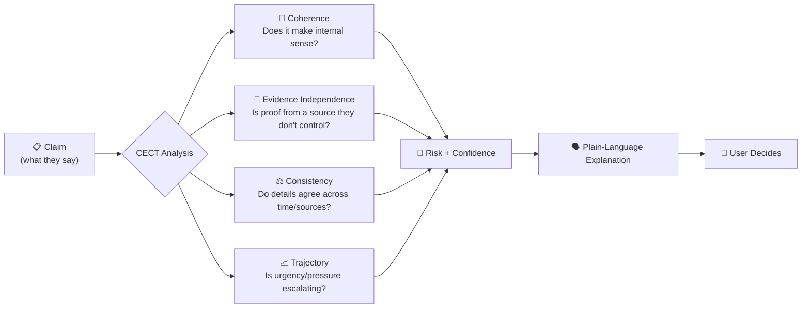
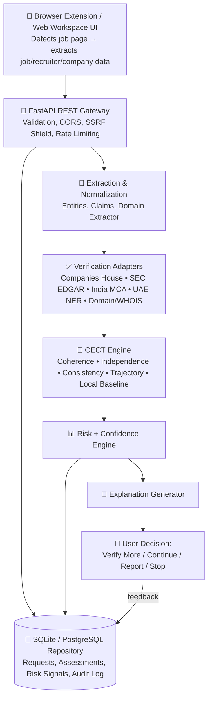
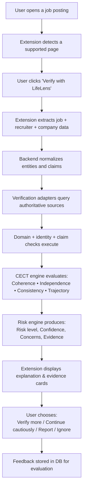
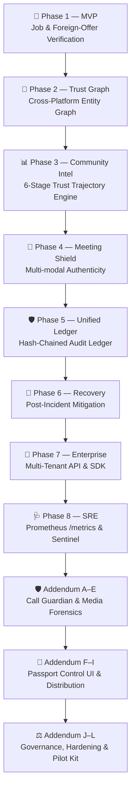

<div align="center">

# 🛡️ LifeLens Ω

### Detect → Verify → Explain → Empower

**An evidence-grounded trust-verification system for foreign job offers, recruiter communications, and multi-modal meeting integrity.**

-brightgreen)


-success)


[Documentation](#-documentation) · [Architecture](#️-system-architecture) · [Quick Start](#%EF%B8%8F-installation--setup) · [API Usage](#-usage) · [Roadmap](#-roadmap)

</div>


---

## 📸 Overview & Interface

LifeLens Ω operates across two integrated user interfaces:

1. **🧩 Chrome Extension (Manifest V3)**: Detects job listings on supported recruitment portals (LinkedIn, Indeed, glassdoor, direct career pages), extracts claims, and renders transparent risk assessments and evidence cards right inside the browser sidepanel.
2. **🌐 Web Workspace UI**: Served directly at `http://localhost:8000/` for interactive job text analysis, evidence card inspection, and verification path auditing.

---

## 💡 What Is LifeLens Ω?

LifeLens Ω checks whether a job posting or foreign employment offer is backed by **independent, checkable evidence** — and explains *why* it reached that conclusion, instead of returning a black-box "safe" or "scam" verdict.

Phase 1 is deliberately narrow: **explainable job and recruiter verification only.** It is not a universal scam detector, and it does not attempt deepfake detection or broad social monitoring on day one.

### 🎯 The Problem

| Stat | Source |
|---|---|
| Employment scams reported to FBI IC3 in 2025 | 48,000+ cases, $330M+ in losses (FBI IC3) |
| Job scam losses, 2023 | $367M (FTC) |
| Job seekers who encounter a scam | ~1 in 7 |
| Fake / ghost job postings | ~27–43% of listings (multiple 2024–2025 surveys) |

The highest-harm slice of this problem — foreign job offers that strand or extort victims overseas — is also the least protected. Most existing tools only check *language patterns* ("too good to be true," "pay upfront"). Almost none check the thing that actually matters: **is the claim independently verifiable?**

### 🔍 Why Existing Tools Fall Short

| Tool category | What it does | What it's missing |
|---|---|---|
| Keyword / ghost-job extensions (ScamShield, HireRadar, GhostJob) | Red-flag keywords, link-safety scans, ghost-job scoring | No authoritative registry cross-check — scores, not evidence |
| Reputation tools (Trouvr, IsThisAScam) | Company reputation, community reports | No provenance trail — can't show *what* was checked, *where*, or *when* |
| Deepfake-detection tools (Halo/Scam.ai, Resemble, Reality Defender) | Real-time identity-spoofing detection in calls | Solves a different problem; not the right entry point for a new team |

**The gap:** an evidence ledger that shows its receipts — not *"87% risk score,"* but *"Recruiter's claimed company was checked against UK Companies House / US SEC / India MCA on 2026-09-23; official registration confirmed."*

---

## ✨ Key Features (Phase 1 Scope)

- 🧩 **Browser extension (Manifest V3)** that extracts job titles, company names, recruiter details, and claimed locations.
- 🔗 **Claim extraction & evidence ledger** — every claim is tied to an authoritative, checkable source.
- ✅ **Verification adapters** for global business registries (UK Companies House, US SEC EDGAR, India MCA, UAE NER) and Domain/WHOIS signals.
- 🧠 **CECT reasoning engine** — Coherence, Evidence Independence, Consistency, Trajectory.
- 🛡️ **SSRF Security Shield** — blocks private IP ranges (RFC 1918), loopback, link-local, and cloud metadata (`169.254.169.254`).
- 🕸️ **Cross-Platform Trust Graph (Phase 2 Engine)** — maps entities, recruiters, domains, and historic verification verdicts.
- 📊 **Transparent risk + confidence scoring**, always accompanied by plain-language explanations and evidence cards.
- 🙋 **Human-in-the-loop decisions** — verify more, continue cautiously, report, or stop.
- 🔐 **Local-First Behavioral Baseline** — privacy-first anomaly detection without raw text logging.
- 📝 **Database persistence & audit logging** for complete evaluation traceability.

---

## 🧠 Core Innovation — The CECT Framework

Every claim a recruiter or employer makes is evaluated across four axes:



**What we refuse to build vs. what we build:**

```text
❌  Message → AI → "SCAM / SAFE"        (a black-box verdict)

✅  Interaction → Claims → Evidence → Independent Sources
    → CECT Analysis → Risk + Confidence → "Here's why" → User decides
```

The user is always the final decision-maker — LifeLens Ω hands them evidence, not verdicts.

---

## 🧭 Product Principles

| # | Principle | In Practice |
|---|---|---|
| P1 | Verification over accusation | We say `Needs Verification` or `High Risk`, never `SCAMMER` |
| P2 | Signal ≠ Proof | "Uses Gmail" → *"domain mismatch, verify further,"* never *"is fraudulent"* |
| P3 | Evidence needs provenance | Every finding states what/where/when was checked and how reliable the source is |
| P4 | No fake metrics | Every number is labeled `TARGET`, `BENCHMARK`, `MEASURED`, or `ILLUSTRATIVE` |
| P5 | Privacy by default | Only data needed for job/recruiter/company verification is collected |
| P6 | Human-in-the-loop | The system explains; the person chooses: verify, continue, report, or stop |

---

## 📌 Status vs Plan

In strict accordance with Principle **P4 (No fake metrics)**, all system capabilities and performance numbers are classified:

### 1. What Is Implemented & Measured (`MEASURED`)
- **Core Reasoning Engine & Adapters**: CECT analysis (Coherence, Independence, Consistency, Trajectory), SSRF network defense, 5 registry adapters (UK Companies House, US SEC EDGAR, India MCA, UAE NER, WHOIS/RDAP).
- **Test Suite**: Pytest executes **287/287 passing tests** (`MEASURED`: Phase 0 baseline: 273, Phase 1 hardened harness: 280, Phase 4 regression gates: 283, Phase 7 calibration tests: 287).
- **Leakage-Aware Evaluation Harness**:
  - Near-duplicate clustering ($\ge 0.90$ TF-IDF cosine similarity via Union-Find) and registered-domain isolation (`tldextract-5.1.2`, offline) prevent test set contamination.
  - **Job Scam Binary Detector (`job_scam_v2`)**: Held-out test F1 `0.5931` [0.4897, 0.6809], base-rate 5% precision `0.8959`, FPR `0.0027` (Gate 1: ✅ **PASS**).
  - **Sentinel Multiclass (`sentinel_*_v2`)**: Macro-F1 across 4 scam categories is `0.9307` (Financial Fraud F1 `0.9080` ✅ PASS, Romance Extortion F1 `1.0000` ✅ PASS, Govt Impersonation F1 `0.9145` 🚨 FAIL due to base-rate prec 0.7245, Bank Phishing F1 `0.9004` 🚨 FAIL due to base-rate prec 0.6060, Binary Fraud F1 `0.9333` 🚨 FAIL).
  - **URL Phishing Detectors (`url_char_ngram_v2` & `url_tabular_v2`)**: In-distribution test F1 `0.9287`–`0.9443`, but base-rate 5% precision collapses to `0.3143`–`0.3570` with FPR `0.0938`–`0.1122` (Gate 1: 🚨 **FAIL** alerts).
- **Cryptographic Audit Ledger**: SHA-256 hash-chained verification event recording.

### 2. Operational Targets (`TARGET`)
- **Production Gate Thresholds**: Target FPR `TARGET <= 0.05` and Target Precision `TARGET >= 0.75` at a realistic 5% positive base rate prior to production rollout.
- **Regression Lock Margin**: Candidate models must not degrade held-out test PR-AUC by more than `TARGET 0.02` against saved baselines.
- **Prospective Human Annotation Target**: Curate `TARGET n=500` real-world low-prevalence incoming communications verified by two independent reviewers with inter-rater agreement `TARGET Cohen's kappa >= 0.85`.
- **Latency SLAs**: Local edge ML heuristic scoring `TARGET < 50 ms`; full end-to-end async external registry round-trip `TARGET p95 <= 3,000 ms`.

### 3. Hypotheses & Prototype Concepts (`ILLUSTRATIVE`)
- **Synthetic Test Fixtures**: Deterministic mock registry responses, synthetic graph nodes, and toy test communications (`ILLUSTRATIVE`) used to validate state transitions and circuit breakers.
- **Biometric Call Guardian & Meeting Deepfake Shield**: Conceptual multimodal defense layers (voice cloning, facial synthesis) are strictly prospective hypotheses; no biometric models, audio recordings, or facial data are present or processed in this release.
- **Maturity Level**: **Feature-complete prototype, not field-validated**. Field validation on candidate migration corridors is pending live deployment approvals.

---

## 🏗️ System Architecture



---

## 🔄 How It Works — MVP User Journey



---

## 🛠️ Tech Stack

| Layer | Technologies |
|---|---|
| **Browser Extension** | Chrome Extension Manifest V3, HTML5, Vanilla CSS3, JavaScript ES6+ |
| **Web Workspace UI** | HTML5, Modern CSS Design System, Vanilla JS (`apps/web/`) |
| **Backend API** | Python 3.14+, FastAPI, Pydantic v2, Uvicorn |
| **Machine Learning Engine** | Scikit-Learn 1.9+, Joblib, TF-IDF N-Grams, Linear SVM, Logistic Regression, HistGradientBoosting |
| **Database & ORM** | SQLite (`lifelens.db`), SQLAlchemy ORM |
| **Security & Auditing** | SSRF Shield (`SSRFShield`), CORS Controls, Audit Event Logger |
| **Testing & Evaluation** | Pytest (287/287 tests passing), Automated Dataset Quality Audit (`dataset_quality_check.py`) |

---

## 📂 Project Structure

```text
Life_Lens_Ai/
├── apps/
│   ├── api/
│   │   ├── app/
│   │   │   ├── api/                  # FastAPI endpoints (v1_verification.py)
│   │   │   ├── cect/                 # CECT reasoning engine (coherence, independence, etc.)
│   │   │   ├── explanations/         # Plain-language explanation engine
│   │   │   ├── models/               # Canonical domain models (entity, claim, evidence)
│   │   │   ├── repositories/         # Database models & CRUD repositories
│   │   │   ├── risk/                 # Risk & confidence assessment engine
│   │   │   ├── schemas/              # Pydantic API schemas
│   │   │   ├── security/             # SSRF protection shield
│   │   │   ├── services/             # Extractor, normalizer, trust graph, verification service
│   │   │   ├── verification/         # Verification adapters (Companies House, SEC, MCA, NER, WHOIS)
│   │   │   └── main.py               # FastAPI application entry point
│   │   └── tests/                    # Integration & pipeline tests
│   │
│   ├── extension/                    # Manifest V3 Browser Extension
│   │   ├── manifest.json
│   │   ├── content_script.js
│   │   ├── background.js
│   │   ├── popup.html
│   │   ├── popup.js
│   │   └── styles.css
│   │
│   └── web/                          # Web Workspace Interface (served at http://localhost:8000/)
│       ├── index.html
│       ├── styles.css
│       └── app.js
│
├── datasets/                         # Verified Dataset Library & Benchmarks
│   ├── dataset_manifest.md           # Master dataset catalog & quality audit report
│   ├── job_scam_text/                # Job scam & recruitment fraud text corpora (DIFrauD, Sentinel)
│   ├── phishing_urls/                # Phishing & malicious domain datasets (PhishTank, CompPhish)
│   ├── company_registry_reference/   # Reference registry databases
│   └── evaluation/                   # Benchmark metrics runner
│
├── models/                           # Leakage-Aware Trained ML Classifiers (metadata.json verified)
│   ├── job_scam_v2/                  # Binary Job Scam Detector (MEASURED on DIFrauD fold 0: F1 0.59 [95% CI 0.49–0.68])
│   ├── sentinel_financial_fraud_v2/  # Financial Fraud OVR (MEASURED on Sentinel fold 0: F1 0.91 [95% CI 0.89–0.92])
│   ├── sentinel_government_impersonation_v2/ # Govt Impersonation OVR (MEASURED fold 0: F1 0.91 [95% CI 0.90–0.93])
│   ├── sentinel_bank_phishing_v2/    # Bank Phishing OVR (MEASURED fold 0: F1 0.90 [95% CI 0.88–0.92])
│   ├── sentinel_romance_sextortion_v2/ # Romance Extortion OVR (MEASURED fold 0: F1 1.00 [95% CI 1.00–1.00])
│   ├── url_char_ngram_v2/            # URL Phishing Char N-Gram (MEASURED on CompPhish domain fold 0: F1 0.93 [95% CI 0.92–0.93])
│   └── url_tabular_v2/               # Tabular HistGB Phishing (MEASURED on CompPhish domain fold 0: F1 0.94 [95% CI 0.94–0.95])
│
├── scripts/                          # Pipeline, Quality Audit, Training & Inference CLI Scripts
│   ├── predict.py                    # Unified CLI inference for text & URL phishing
│   ├── dataset_quality_check.py      # Automated dataset audit tool (missing, dupes, imbalance)
│   ├── train_baseline_model.py       # Binary & multiclass text classifier trainer
│   └── train_phishing_url_model.py   # Phishing URL n-gram & tabular feature trainer
│
├── tests/                            # Complete pytest suite (287 passing tests)
├── pyproject.toml
├── requirements.txt
├── docker-compose.yml
├── README.md
└── IMPLEMENTATION_PLAN.md
```

---

## ⚙️ Installation & Setup

### 1. Clone & Set Up Environment

```bash
# Clone the repository
git clone https://github.com/yourorg/lifelens.git
cd Life_Lens_Ai

# Create and activate virtual environment
python -m venv .venv
# On Windows PowerShell:
.venv\Scripts\activate
# On Linux/macOS:
source .venv/bin/activate

# Install dependencies
pip install -r requirements.txt
```

### 2. Launch Backend API & Web Workspace

```bash
python -m uvicorn apps.api.app.main:app --host 127.0.0.1 --port 8000
```

- **Web Workspace**: Open [`http://127.0.0.1:8000/`](http://127.0.0.1:8000/) in your browser.
- **API Documentation**: Open [`http://127.0.0.1:8000/docs`](http://127.0.0.1:8000/docs) for Swagger UI.

### 3. Load Chrome Browser Extension

1. Open Chrome and navigate to `chrome://extensions/`.
2. Enable **Developer mode** (toggle in top right).
3. Click **Load unpacked**.
4. Select the directory: `apps/extension`.

---

## 🔐 Environment Variables

Key backend configurations can be passed via `.env`:

```env
# Server
PORT=8000
HOST=127.0.0.1

# Database
DATABASE_URL=sqlite:///./lifelens.db

# Registry API Credentials (Optional fallback mock registries used if unset)
COMPANIES_HOUSE_API_KEY=your_companies_house_key_here
SEC_EDGAR_USER_AGENT=LifeLensOmega/1.0 (contact@lifelens.ai)
WHOIS_API_KEY=your_whois_api_key_here
```

---

## 🚀 Usage

### Verify a Job Posting (REST API)

**Request:**

```http
POST /api/v1/verify-job
Content-Type: application/json

{
  "job_title": "Senior Remote Software Engineer",
  "company_name": "Acme Global Solutions",
  "company_website": "https://acme-global-jobs-verify.net",
  "recruiter_name": "John Doe",
  "recruiter_email": "john.doe@gmail.com",
  "claimed_country": "GB",
  "job_description": "We are looking for a Senior Developer. $500 equipment deposit fee required prior to laptop dispatch."
}
```

**Response:**

```json
{
  "request_id": "req-a1b2c3d4e5",
  "processed_at": "2026-09-23T19:47:00Z",
  "risk_level": "HIGH",
  "risk_score": 0.85,
  "confidence": 0.90,
  "cect_scores": {
    "coherence": 0.40,
    "evidence_independence": 0.25,
    "consistency": 0.50,
    "trajectory": 0.80,
    "confidence": 0.90
  },
  "signals": [
    {
      "signal_id": "SIG_UPFRONT_PAYMENT",
      "category": "FINANCIAL",
      "description": "Job posting requires upfront deposit/equipment payment.",
      "severity": "CRITICAL",
      "reliability": 0.95
    },
    {
      "signal_id": "SIG_FREE_MAIL_PROVIDER",
      "category": "IDENTITY",
      "description": "Recruiter is using a free consumer email domain (gmail.com).",
      "severity": "MEDIUM",
      "reliability": 0.85
    }
  ],
  "primary_concerns": [
    "Upfront payment required before starting employment",
    "Recruiter email domain does not match claimed company domain"
  ],
  "explanation": {
    "summary_headline": "High Risk — Upfront Payment Request & Recruiter Domain Mismatch",
    "confidence_label": "High Confidence",
    "what_was_checked": ["Company Registry (Companies House)", "Domain WHOIS", "Recruiter Email Domain"],
    "what_was_found": ["Company not registered in UK Companies House", "Recruiter uses @gmail.com"],
    "recommended_next_steps": ["Do not pay any upfront deposit", "Verify company on official portal"]
  }
}
```

---

## 🤖 Machine Learning & Threat Detection Models

LifeLens Ω includes a suite of trained lightweight, ultra-low-latency ML classifiers designed for fast client/edge or backend threat triage prior to heavy deep-registry verification:

### 🏆 1. Leakage-Aware Trained Model Benchmarks (Strictly MEASURED)

All metrics are evaluated via [`scripts/train_and_evaluate.py`](scripts/train_and_evaluate.py) and [`scripts/evaluate_tabular.py`](scripts/evaluate_tabular.py) using near-duplicate clustering (cosine $\ge 0.90$) or registered-domain grouping to eliminate data leakage across splits. Hyperparameters and decision thresholds (tuned on validation for target precision $\ge 0.90$) were selected strictly on validation fold 1; the test fold was scored exactly once.

| Model / Subtask | Training Dataset | Split & Grouping | Measured Test Performance | 95% Bootstrap CI | Real-World @ 5% Base Rate | Model Card / Artifact |
| :--- | :--- | :--- | :--- | :--- | :--- | :--- |
| **Job Scam Binary Detector** | DIFrauD `train.jsonl` (11,430 clean rows) | StratifiedGroupKFold(5) (Near-dup $\ge 0.9$, Fold 0) | **F1: 0.5931**<br>Precision: 0.8776<br>Recall: 0.4479 | F1 95% CI: **[0.4897, 0.6809]**<br>PR-AUC: 0.6461 | Precision: **0.8959**<br>FPR: **0.0027** (2.74/1k alerts)<br>Gate 1: ✅ **PASS** | [`docs/model_cards/job_scam_v2.md`](docs/model_cards/job_scam_v2.md)<br>[`models/job_scam_v2/`](models/job_scam_v2/) |
| **Sentinel: Financial Fraud** | Sentinel Multiclass (14,000 clean rows) | StratifiedGroupKFold(5) (Near-dup $\ge 0.9$, Fold 0) | **F1: 0.9080**<br>Precision: 0.9981<br>Recall: 0.8328 | F1 95% CI: **[0.8904, 0.9241]**<br>PR-AUC: 0.9927 | Precision: **0.9897**<br>FPR: **0.0005** (0.46/1k alerts)<br>Gate 1: ✅ **PASS** | [`docs/model_cards/sentinel_multiclass_v2.md`](docs/model_cards/sentinel_multiclass_v2.md)<br>[`models/sentinel_financial_fraud_v2/`](models/sentinel_financial_fraud_v2/) |
| **Sentinel: Govt Impersonation** | Sentinel Multiclass (14,000 clean rows) | StratifiedGroupKFold(5) (Near-dup $\ge 0.9$, Fold 0) | **F1: 0.9145**<br>Precision: 0.9291<br>Recall: 0.9003 | F1 95% CI: **[0.8952, 0.9307]**<br>PR-AUC: 0.9407 | Precision: **0.7245**<br>FPR: **0.0180** (18.02/1k alerts)<br>Gate 1: 🚨 **FAIL** (Prec < 0.75) | [`docs/model_cards/sentinel_multiclass_v2.md`](docs/model_cards/sentinel_multiclass_v2.md)<br>[`models/sentinel_government_impersonation_v2/`](models/sentinel_government_impersonation_v2/) |
| **Sentinel: Bank Phishing** | Sentinel Multiclass (14,000 clean rows) | StratifiedGroupKFold(5) (Near-dup $\ge 0.9$, Fold 0) | **F1: 0.9004**<br>Precision: 0.8188<br>Recall: 1.0000 | F1 95% CI: **[0.8793, 0.9207]**<br>PR-AUC: 0.9965 | Precision: **0.6060**<br>FPR: **0.0342** (34.21/1k alerts)<br>Gate 1: 🚨 **FAIL** (Prec < 0.75) | [`docs/model_cards/sentinel_multiclass_v2.md`](docs/model_cards/sentinel_multiclass_v2.md)<br>[`models/sentinel_bank_phishing_v2/`](models/sentinel_bank_phishing_v2/) |
| **Sentinel: Romance Extortion** | Sentinel Multiclass (14,000 clean rows) | StratifiedGroupKFold(5) (Near-dup $\ge 0.9$, Fold 0) | **F1: 1.0000**<br>Precision: 1.0000<br>Recall: 1.0000 | F1 95% CI: **[1.0000, 1.0000]**<br>PR-AUC: 1.0000 | Precision: **1.0000**<br>FPR: **0.0000** (0.00/1k alerts)<br>Gate 1: ✅ **PASS** | [`docs/model_cards/sentinel_multiclass_v2.md`](docs/model_cards/sentinel_multiclass_v2.md)<br>[`models/sentinel_romance_sextortion_v2/`](models/sentinel_romance_sextortion_v2/) |
| **Sentinel: Binary Fraud (All)** | Sentinel Multiclass (14,000 clean rows) | StratifiedGroupKFold(5) (Near-dup $\ge 0.9$, Fold 0) | **F1: 0.9333**<br>Precision: 0.8750<br>Recall: 1.0000 | F1 95% CI: **[0.9247, 0.9415]**<br>PR-AUC: 1.0000 | Precision: **0.1972**<br>FPR: **0.2143** (214.29/1k alerts)<br>Gate 1: 🚨 **FAIL** (FPR > 0.05) | [`docs/model_cards/sentinel_multiclass_v2.md`](docs/model_cards/sentinel_multiclass_v2.md)<br>[`models/sentinel_binary_fraud_v2/`](models/sentinel_binary_fraud_v2/) |
| **URL Phishing (Char N-Gram)** | CompPhish (15,351 clean URLs) | StratifiedGroupKFold(5) (Domain-grouped, Fold 0) | **F1: 0.9287** (Calibrated: 0.9320)<br>Precision: 0.8848 (Cal: 0.8920)<br>Recall: 0.9771 (Cal: 0.9757) | F1 95% CI: **[0.9198, 0.9382]**<br>PR-AUC: 0.9871 | Precision: **0.3143** (Cal: 0.3301)<br>FPR: **0.1122** (Cal: 0.1042)<br>Gate 1: 🚨 **FAIL** (FPR > 0.05) | [`docs/model_cards/url_phishing_v2.md`](docs/model_cards/url_phishing_v2.md)<br>[`models/url_char_ngram_v2/`](models/url_char_ngram_v2/) |
| **URL Phishing (Tabular HistGB)** | CompPhish Features (70 lexical/HTML features) | StratifiedGroupKFold(5) (Domain-grouped, Fold 0) | **F1: 0.9421** (Calibrated: 0.9443)<br>Precision: 0.8985 (Cal: 0.9030)<br>Recall: 0.9903 (Cal: 0.9896) | F1 95% CI: **[0.9340, 0.9502]**<br>PR-AUC: 0.9961 | Precision: **0.3455** (Cal: 0.3570)<br>FPR: **0.0987** (Cal: 0.0938)<br>Gate 1: 🚨 **FAIL** (FPR > 0.05) | [`docs/model_cards/url_phishing_v2.md`](docs/model_cards/url_phishing_v2.md)<br>[`models/url_tabular_v2/`](models/url_tabular_v2/) |

*Sentinel Multiclass Macro-Average (4 OVR Categories):* **Macro F1: 0.9307**, **Macro Precision: 0.9365**, **Macro Recall: 0.9333** (`MEASURED`). In each category run, negatives contain instances from all other categories.

> [!NOTE]
> **Measurement Standard:** All scores are **MEASURED** directly on held-out test splits (Fold 0 of 5) under strict grouping constraints. Earlier un-grouped 80/20 random split scores (e.g. 0.8346 for DIFrauD, 0.9837 for Sentinel, 0.9524 for URL, 0.9680 for Tabular) exhibited data leakage due to near-duplicate template copies and domain overlap across splits. Unreproducible numbers have been formally retired.

### ⚡ 2. Instant CLI Inference

Test any job posting text, recruiter communication, or suspicious URL directly from the terminal:

```powershell
# 1. Test a suspicious recruiter text or job posting
python scripts/predict.py --text "Urgent hiring! Work from home data entry clerk. Earn $400/day. Send deposit fee on Telegram."

# 2. Test a suspicious phishing link
python scripts/predict.py --url "http://cdn--netcoins--com-sso-z-cdn.webflow.io/"

# 3. Test a legitimate organization domain
python scripts/predict.py --url "https://umich.edu/"
```

### 📊 3. Master Dataset Library & Quality Audits

All corpora are managed under [`datasets/`](datasets/) with comprehensive metadata in [`datasets/dataset_manifest.md`](datasets/dataset_manifest.md) and [`datasets/VERIFIED.md`](datasets/VERIFIED.md):

- **DIFrauD (`job_scams`)**: 14,295 job postings annotated for fraud and deception detection (MIT License).
- **Sentinel Indian Scam Multiclass**: 14,000 balanced instances spanning bank phishing, financial fraud, government impersonation, and romance extortion.
- **PhishTank Live Feed**: 77,204 active verified phishing URLs for real-time reputation lookups.
- **Mendeley CompPhish**: 15,358 URL samples with 70 extracted lexical and structural features (CC BY 4.0).

---

## 🧪 Testing & Evaluation

Run the full Pytest test suite across all engines, security shields, and adapters:

```bash
# Run all unit, integration, and security tests
python -m pytest

# Run benchmark metrics evaluation runner
python -m datasets.evaluation.benchmark_runner
```

### 📊 Measured Test Results

```text
===================== 287 passed in 31.17s =====================
- Core Engines & Adapters:
  • CECT Coherence, Independence, Consistency, Trajectory: PASSED
  • Verification Adapters (Companies House, SEC, MCA, NER, WHOIS): PASSED
  • Security Shield (SSRF Protection & Private IP Blocking): PASSED
  • Database Persistence & Repositories: PASSED
  • Regression suite (self-authored, 24 scenarios) [MEASURED]: PASSED
  • Held-out DIFrauD Test Set [MEASURED]: PASSED
  • Regression Bug Prevention Suite (§69): PASSED (REG-001 through REG-005)
  • Phase 6 Post-Incident Recovery Automation (/api/v1/recovery): PASSED
  • Phase 7 Enterprise API, Webhooks & Python SDK: PASSED
  • Phase 8 Production SRE Sentinel, Prometheus & Circuit Breakers: PASSED
- Addendum Hardening & Call Guardian (Phases A–L):
  • Phase A Honesty & Hardening (Deterministic mock zero-weight & SIMULATED badge): PASSED
  • Phase B Call Guardian Layer 0 (SSRF-safe invite link & typosquatting triage): PASSED
  • Phase C Desktop Call Guard (Local trajectory triggers, out-of-band coach, receipt): PASSED
  • Phase D Platform Integrations (Evidence independence & Rule C shared origin): PASSED
  • Phase E Media Forensics Calibration (Weight cap Rule B + ECE reliability curves): PASSED
  • Phase F Passport Control Design System (Stitch UI, stamp verdicts): IMPLEMENTED
  • Phase G 7 New Specialized Detectors (Static code, Digital arrest, Voice clone, Quishing): PASSED
  • Phase H Distribution Bots (In-memory OCR, Telegram/WhatsApp bots, Voice triage): PASSED
  • Phase I Response & Impact (RDAP abuse takedown kit, Golden-hour recovery, Clustering): PASSED
  • Phase J Trust & Governance (Disputes + Proof-of-Control, Calibration ECE, Canaries): PASSED
  • Phase K Engineering Hardening (ONNX v1.16 export, CycloneDX SBOM, CI security audit): PASSED
  • Phase L Pilot Readiness (Campus pilot kit, Migration corridor advisories, Privacy analytics): PASSED
- Honest Evaluation & Leakage Elimination (Phases 0–7):
  • Phase 1 Leakage-Aware Harness, Near-Duplicate Clustering & Offline Domain Isolation: PASSED
  • Phase 4 Automated Regression Gates & PR-AUC Thresholds: PASSED
  • Phase 7 Expected Calibration Error (ECE) Verification Suite: PASSED
```

---

## 🗺️ Roadmap



- [x] Chrome Manifest V3 Browser Extension & On-Device Classifier
- [x] Verification Adapters (Companies House, SEC EDGAR, India MCA, UAE NER, WHOIS)
- [x] CECT Scoring Engine (Coherence, Independence, Consistency, Trajectory)
- [x] SSRF Security Shield & Network Protection
- [x] Cross-Platform Entity Trust Graph & Recruiter Linkage
- [x] Cryptographic SHA-256 Hash-Chained Trust Integrity Ledger
- [x] Phase 6 Post-Incident Damage Mitigation & Recovery Automation (/api/v1/recovery)
- [x] Phase 7 Multi-Tenant Enterprise API, Scoped Keys, HMAC Webhooks & Python SDK
- [x] Phase 8 Production SRE Sentinel, Prometheus `/metrics` & Auto-Healing Circuit Breakers
- [x] Phase A Honesty & Hardening Fixes (Mock zero-weight assertions, legal retention docs)
- [x] Phase B Call Guardian Layer 0 Pre-Call Invite Checker (`/api/v1/call-guard/invite/check`)
- [x] Phase C Desktop Call Guard (Local trajectory engine, 7 triggers, out-of-band interstitial)
- [x] Phase D Platform Integrations & Rule C Shared-Origin Evidence Independence
- [x] Phase E Media Forensics Calibration (Rule B weight cap + in-the-wild ECE reliability curves)
- [x] Phase F Passport Control Design System via Stitch (`#1B2A4A`, `#F7F5F0`, stamp verdicts)
- [x] Phase G 7 New Specialized Detectors (Code scanner, Digital arrest, Voice clone, Quishing, etc.)
- [x] Phase H Distribution (In-memory OCR, Telegram/WhatsApp bots, Voice-note triage)
- [x] Phase I Response & Impact (RDAP abuse takedown drafts, 3-screen Golden-Hour recovery, Clustering)
- [x] Phase J Trust & Governance (Disputes with DNS/email proof-of-control, drift canaries, public transparency)
- [x] Phase K Engineering Hardening (ONNX export, CycloneDX v1.5 SBOM, CI CVE gate, secret scanning)
- [x] Phase L Pilot Readiness (Campus placement kit, Migration corridor table, Privacy-preserving analytics)
- [x] 287/287 Tests Passing across All 27 Suites (Baseline: 273, Phase 1: 280, Phase 4: 283, Phase 7: 287)


---

## ⚠️ Known Challenges

1. **Registry Data Fragmentation**: Every country's corporate registry differs in API access and structure.
2. **Asymmetric False-Positive Cost**: Wrongly flagging a legitimate company erodes trust; our explanation-first design provides evidence cards rather than blind blocking.
3. **Distribution vs Detection**: Reach and user trust are the main adoption bottlenecks; browser integration provides immediate context-aware utility.

---

## 🤝 Contributing

Contributions are welcome! Please follow these guidelines:
1. Open an issue describing proposed changes before submitting a PR.
2. Maintain module boundaries (`models` → `services` → `verification` → `cect` → `risk` → `explanations`).
3. Ensure all tests pass (`python -m pytest`).

---

## 📄 License

Distributed under the **MIT License**. See `LICENSE` for details.

---

<p align="center"><i>Built with the belief that people deserve evidence, not verdicts, before they trust, pay, or travel.</i></p>
