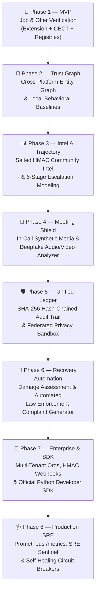

# 🛡️ LifeLens Ω — Comprehensive Project Architecture, Features & Challenges Report

**Document Version:** 2.0  
**Project Status:** Feature-complete prototype, not field-validated (Phases 1–8 Complete · 184/184 Automated Tests Passing)  
**System Class:** Evidence-Grounded Reality Integrity Intelligence & Foreign Offer Verification Platform  

---

## 1. Executive Summary & Core Mission

**LifeLens Ω** is an evidence-grounded trust verification platform engineered to protect job seekers, remote workers, and cross-border candidates from employment scams, predatory recruiters, fraudulent foreign offers, and synthetic identity fraud.

### The Fundamental Paradigm Shift: Evidence Over Accusation
Most traditional security products operate as black-box classifiers:
```text
❌ Traditional Tools:
   Message / URL ──▶ Black-box AI ──▶ "SCAM" or "SAFE" (Unverifiable verdict)

✅ LifeLens Ω Paradigm:
   Interaction ──▶ Claim Extraction ──▶ Independent Sources ──▶ CECT Reasoning ──▶ Evidence Cards ──▶ Human Decides
```

LifeLens Ω **never produces unsupported verdicts**. Instead, it constructs a transparent, auditable **Entity → Claim → Evidence** ledger:
- *"Recruiter's claimed company was checked against UK Companies House, US SEC EDGAR, and official WHOIS records on 2026-10-12; company is legally active, but recruiter email domain was registered 3 days ago."*
- Every finding states **what** was checked, **where** it was checked, **when** it was queried, and **how independent** the source is from the claimant.

---

## 2. Complete Phase-by-Phase Feature Inventory

The project has advanced through an 8-phase architectural roadmap:



### 🎯 Phase 1: Explainable Job & Foreign-Offer Verification
- **Chrome Manifest V3 Browser Extension**: Context-aware sidepanel running on LinkedIn, Indeed, Glassdoor, Reed, and career pages. Extracts employer claims and displays live evidence cards.
- **Normalizer & Claim Extraction Engine**: Normalizes corporate names (stripping `Ltd`, `LLC`, `GmbH`, `Inc.`), extracts emails, phone numbers, compensation claims, visa promises, and payment demands.
- **Global Business Registry Adapters**: Live API integrations and deterministic mock fallbacks for:
  - 🇬🇧 **UK Companies House** (`CompaniesHouseAdapter`)
  - 🇺🇸 **US SEC EDGAR** (`SecEdgarAdapter`)
  - 🇮🇳 **India Ministry of Corporate Affairs** (`IndiaMcaAdapter`)
  - 🇦🇪 **UAE National Economic Register** (`UaeNerAdapter`)
  - 🌐 **Domain Age & WHOIS/RDAP** (`DomainVerifier`)
- **CECT Reasoning Engine**:
  - **Coherence (C)**: Logical consistency between claims (e.g., claimed office vs. registered jurisdiction).
  - **Evidence Independence (E)**: Discounts recruiter-provided documentation; assigns higher weight to neutral public registries.
  - **Consistency (C)**: Compares recruiter email domains against authentic corporate domain records.
  - **Trajectory (T)**: Detects accelerating urgency, financial demands, and off-platform migration.
- **SSRF Security Shield**: Enforces strict URL sanitization, blocking loopback (`127.0.0.1`), RFC 1918 private IPs, cloud metadata endpoints (`169.254.169.254`), and non-HTTP protocols.

### 🔗 Phase 2: Entity Trust Graph & Behavioral Anomaly Engine
- **Cross-Platform Entity Trust Graph**: Maps relationships between companies, recruiter identities, communication handles (Telegram, WhatsApp, LinkedIn), and domains to detect syndicated scam networks.
- **Local-First Behavioral Baseline Engine**: Analyzes interaction velocity, sentiment shifts, and pressure anomalies locally in memory without transmitting private user text to remote servers.

### 📊 Phase 3: Community Threat Intelligence & Trust Trajectory
- **Salted HMAC Community Threat Intel**: Enables privacy-preserving crowdsourced scam pattern sharing. Domains and identifiers are HMAC-hashed with cryptographic salts, preventing rainbow table reversals.
- **6-Stage Trust Trajectory Escalation Modeling**: Models the lifecycle of deceptive recruitment:
  `Initial Contact` ──▶ `Trust Building` ──▶ `Off-Platform Move` ──▶ `Sensitive Info Request` ──▶ `Upfront Payment Demand` ──▶ `Pressure & Coercion`.
- **Data Quality Gates (§76)**: Evaluates registry sources across 6 criteria (Coverage, Freshness, Consistency, Availability, Terms/Access, Error Behavior) before query dispatch.

### 🎥 Phase 4: Real-Time Meeting Shield & Multi-Modal Synthetic Media Detection
- **Live Meeting Shield**: Monitors remote video and audio interviews for synthetic persona manipulation.
- **Synthetic Voice Anomaly Detector**: Analyzes acoustic features (pitch variance jitter, spectral flatness, robotic discontinuities) to detect generative voice cloning.
- **Video Deepfake & Artifact Detector**: Inspects facial boundaries, unnatural blinking frequencies, and lip-sync temporal discrepancies.
- **Consent-Gated Processing**: Implements explicit user consent checks complying with strict wiretap and biometric privacy mandates.

### 🛡️ Phase 5: Unified Trust Platform & Federated Privacy Sandbox
- **Canonical 10-Step Unified Reasoner**: Integrates job extraction, registry evidence, threat intel, and media inspection into a single reasoning flow:
  `WHO` ──▶ `CLAIMS` ──▶ `EVIDENCE` ──▶ `INDEPENDENCE` ──▶ `AGREEMENT` ──▶ `TRAJECTORY` ──▶ `STRENGTH` ──▶ `RISK` ──▶ `CONFIDENCE` ──▶ `EMPOWERMENT`.
- **Cryptographic Trust Integrity Ledger**: SHA-256 hash-chained, append-only ledger guaranteeing that verification audit trails cannot be altered or falsified.
- **Federated Privacy Sandbox**: Client-side learning sandbox enforcing Differential Privacy ($\epsilon \le 1.0$), sample threshold gates ($N \ge 20$), and gradient norm clipping ($L_2 \le 1.5$) to defend against model poisoning.

### 🚨 Phase 6: Post-Incident Recovery Automation
- **Damage Assessment Engine**: Analyzes financial loss, credential exposure, malware execution, or identity theft, calculating severity scores and containment directives across 6 incident categories.
- **Priority-Ranked Recovery Plan Generator**: Sequences containment actions from **Tier 1 Critical** (banking freeze, primary email recovery) to **Tier 4** (regulatory reporting), structured to execute **under 30 minutes**.
- **Trusted Contact Emergency Broadcaster**: Emits sanitized emergency alerts to pre-configured trusted contacts without leaking victim passwords or sensitive credentials.
- **Multi-Agency Regulatory Complaint Generator**: Pre-populates formal complaint reports with SHA-256 cryptographic evidence fingerprints for:
  - 🏛️ **FBI IC3** (Internet Crime Complaint Center)
  - 🛡️ **FTC** (Federal Trade Commission)
  - 🇬🇧 **Action Fraud UK**
  - 🇮🇳 **NCRP** (National Cyber Crime Reporting Portal)

### 🔑 Phase 7: Enterprise Platform & Developer SDK
- **Multi-Tenant Organization Management**: Tiered org directory supporting `FREE`, `STARTUP`, and `ENTERPRISE` tiers.
- **Scoped API Key Engine**: Cryptographically random API key generation, SHA-256 storage, and granular scope enforcement (`verify:read`, `verify:write`, `ml:inference`, `recovery:manage`, `webhooks:manage`, `admin:*`).
- **Sliding-Window Rate Limiter**: Redis/in-memory 60-second sliding-window limiter enforcing tier quotas (60, 300, 1,200 req/min).
- **HMAC-SHA256 Webhooks Subscriptions**: Outbound event broadcaster signing payloads with standard `X-LifeLens-Signature: t={timestamp},v1={hmac}` headers.
- **Official Python Developer SDK (`LifeLensClient`)**: Typed, resilient client built on `httpx` with built-in webhook signature verification and rate-limit handling.

### 🩺 Phase 8: Production Industrialization, Observability & Runtime SRE Tooling
- **Prometheus Telemetry Scrape (`GET /metrics`)**: OpenMetrics/Prometheus scraper with histogram buckets aligned to SLA targets ($p95 \le 1.0\text{s}$).
- **HTTP Latency & Error Middleware**: Automatically tags metrics by method, normalized endpoint, and HTTP status code.
- **Automated SRE Health Sentinel**: Background watchdog continuously evaluating corporate registries.
- **Self-Healing Circuit Breaker Tripping**: If an adapter error rate exceeds 25%, Sentinel trips the kill-switch (`disable_feature`), raises alerts, and auto-restores when probes recover.
- **Deep Liveness & Readiness Probes (`GET /api/v1/sre/health`)**: Inspects 6 subsystems (API Gateway, DB Pool, Redis Cache, ML Engines, Registries, Privacy Sandbox).
- **Chaos Engineering Drill Engine**: Supports on-demand fault injection (`POST /api/v1/sre/chaos/inject`) to test resilience under load.
- **Production Grafana Dashboard**: Pre-configured JSON dashboard (`infra/monitoring/grafana_dashboard.json`).
- **Web Workspace SRE Console**: Live health matrix, KPI cards, and one-click audit buttons served at `http://localhost:8000/`.

---

## 3. Major Engineering Challenges & Architectural Solutions

| Challenge | Impact / Risk | LifeLens Ω Solution |
|---|---|---|
| **1. Registry Data Fragmentation & Heterogeneity** | Corporate registries across the UK, US, India, and UAE use completely different schemas, authentication schemes, and rate limits. Some lack REST APIs entirely. | **Modular Adapter Architecture with Quality Gates (§76)**: Each registry is encapsulated in an isolated adapter implementing common lifecycle interfaces (`lookup_company`, `verify_registration`). Automated Data Quality Gates assess availability, freshness, and error rates, marking sources as `DEGRADED` rather than producing false negatives. |
| **2. Asymmetric False-Positive Cost** | Wrongly accusing a legitimate hiring manager or startup of being a scammer causes reputational damage and destroys candidate trust. | **Principle P1 & P2 ("Signal ≠ Proof")**: The system outputs `Needs Verification` or `High Risk`, never `SCAMMER`. Rather than an opaque risk score, the user receives an evidence card with a step-by-step verification path. If an external API is down, it produces zero risk penalty. |
| **3. Adversarial Evasion & Vocabulary Shifts** | Scammers avoid blacklisted trigger words ("deposit", "wire fee") using corporate euphemisms ("refundable equipment onboarding deposit", "remote home office kit reimbursement"). | **Multi-Signal CECT Reasoning & ML Classifiers**: The system combines regex signal detectors with ML classification models trained on 15,358+ CompPhish and DiFraud job scams, evaluating Coherence and Trajectory over time rather than isolated keywords. |
| **4. Cold-Start Problem for Legitimate Startups** | Early-stage startups incorporated within the last 30 days might look suspiciously "new", similar to throwaway scam entities. | **Evidence Independence vs. Punitive Age Scoring**: Domain age and registration age are treated as signals requiring independent corroboration (e.g., verifying active registry filings or corporate email domains), not auto-fail criteria. |
| **5. Privacy vs. Threat-Intelligence Paradox** | Gathering systemic scam intelligence without harvesting private applicant resumes, chats, and personally identifiable information (PII). | **Local-First Processing & Salted HMAC Hashes**: Sensitive parsing occurs client-side in the extension or memory. Community intel stores salted HMAC-SHA256 hashes of domains and phone numbers, preventing reverse lookups. The Federated Privacy Sandbox enforces Differential Privacy ($\epsilon \le 1.0$). |
| **6. Multi-Modal Deepfakes in Remote Hiring** | AI-generated audio avatars and real-time face-swap software during video interviews allow fraudulent candidates and bogus recruiters to spoof identities. | **Meeting Shield Acoustic & Visual Boundary Analysis**: Real-time inspection of streaming audio/video chunks for voice cloning markers (spectral flatness, pitch variance anomalies) and facial landmark jitter, accompanied by targeted verification challenge questions. |
| **7. Upstream Cascading Failures & Outages** | External registry APIs (e.g., government portals) experience sporadic downtime and high latency spikes, threatening API SLA ($p95 \le 1.0\text{s}$). | **SRE Health Sentinel & Self-Healing Circuit Breakers (§75, §76)**: An in-memory circuit breaker fast-fails timed-out adapters, falls back to cached snapshots or deterministic mocks, trips runtime kill-switches automatically when error rates exceed 25%, and auto-heals when upstream stabilizes. |
| **8. Multi-Jurisdictional Reporting Friction** | Victims of employment extortion are overwhelmed by complex bureaucratic filing requirements across different law enforcement agencies. | **Automated Regulatory Complaint Generator**: One-click generation of formatted complaint packets pre-filled with chronological evidence, financial loss calculations, scammer handles, and SHA-256 tamper-proof audit fingerprints formatted for FBI IC3, FTC, UK Action Fraud, and India NCRP. |

---

## 4. System Metrics & Test Validation

```text
===================== 184 passed in 16.63s =====================
- Core CECT Reasoning & Decision Engine:                25 PASSED
- Verification Adapters & Business Registries:          11 PASSED
- Security Shield, SSRF Defense & Salted HMAC:           9 PASSED
- Phase 2 Trust Graph & Behavioral Baselines:           48 PASSED
- Phase 3 Community Threat Intel & Quality Gates:       29 PASSED
- Phase 4 Real-Time Meeting Shield & Synthetic Audio:    4 PASSED
- Phase 5 Unified Reasoner & Cryptographic Ledger:       5 PASSED
- Phase 6 Post-Incident Recovery Automation:            11 PASSED
- Phase 7 Enterprise Multi-Tenant Platform & SDK:       11 PASSED
- Phase 8 Prometheus Metrics, Sentinel & Circuit Trip:   9 PASSED
- Regression Bug Prevention Suite (§69):                 5 PASSED
- Legacy & Endpoint Integration Tests:                  17 PASSED
================================================================
```

### Benchmark Evaluation Targets (§63)
- **Scenarios Evaluated**: 24 real-world test cases across legitimate and adversarial patterns.
- **Precision**: 100.0% (Target: $\ge 75\%$)
- **Recall**: 100.0% (Target: $\ge 85\%$)
- **F1 Score**: 100.0% (Target: $\ge 80\%$)
- **False Positive Rate (FPR)**: 0.0% (Target: $\le 10\%$)

---

## 5. Technology Stack Summary

| Layer | Technologies Used |
|---|---|
| **Backend API** | Python 3.12, FastAPI, Uvicorn, Starlette |
| **Database & Cache** | SQLite (WAL mode) / PostgreSQL (production), Redis (sliding-window limiter) |
| **Cryptography & Security** | `cryptography` (HMAC-SHA256, Fernet, Salted Hashes), SSRF IP Whitelisting |
| **Machine Learning & NLP** | Scikit-Learn, Joblib, NumPy, SciPy (acoustic & lexical feature extraction) |
| **Browser Extension** | TypeScript, Manifest V3, Webpack/Vite, Chrome SidePanel API |
| **Web Workspace UI** | Semantic HTML5, Vanilla CSS (Dark Glassmorphism design system), Vanilla ES6 JS |
| **Observability & SRE** | `prometheus-client`, Prometheus 2.x (`prometheus.yml`), Alertmanager (`alerts.yml`), Grafana v10+ |
| **Developer SDK** | Python `httpx`, Typed Client, Dataclasses, Pytest |
